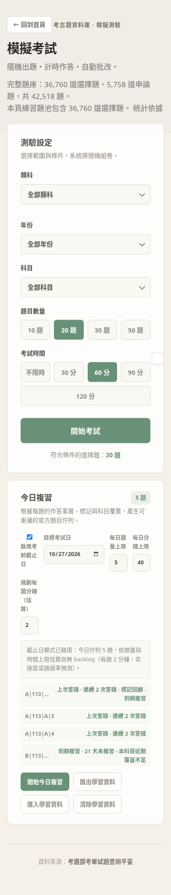
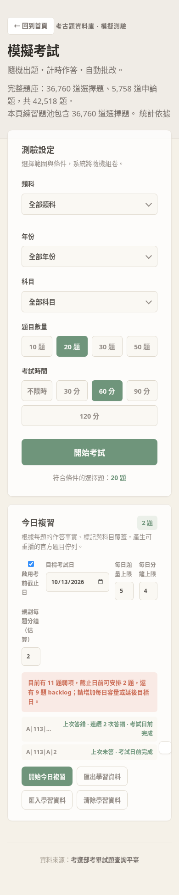

# Issue 60: source-bound local review acceptance

The candidate integrates current master ac8ed445 normally and preserves the existing modern answer, passage, image and durable IndexedDB checkpoint contracts. Review uses the full eligible bank independently of the exam-filter controls. The per-question ledger binds the raw canonical content hash before display escaping and carries source PDF/page/SHA/locator and actual applied filters. The official corpus probe produced 42,482 unique composite IDs from 42,482 rows, with zero collisions; an independent review repeated the complete probe and found zero identity changes from parsed source locators.

Daily planning capacity is `min(question limit, floor(minutes/planning minutes per question))`. The rate is explicitly a user planning estimate, not measured speed or predicted performance. Zero minutes disables the time cap/timer. Review settings are bounded to 200 questions and 1440 minutes, consistent with the existing checkpoint validator. Due dates are clamped to the user target and insufficient capacity shows backlog.

On submission the ledger commits before the durable checkpoint is cleared. A ledger quota failure leaves recovery intact; cleanup retry retains the same attempt batch and does not duplicate learning facts. Pre-ledger snapshots have no reliable official ID: their distinct session/question snapshots export as `UNMAPPED_REVIEW_REQUIRED` and never silently join an official question. Failed migration persistence retains its unavailable/conflict status. LocalStorage ledger writes do not provide concurrent multi-tab transactions; the documented single-submission-tab limitation remains.

## Executed evidence

- Python 3.11.17 / Node: full original `REQUIRE_NODE_FOR_TESTS=1 .venv/bin/python -m pytest tests/ -q`: **355 passed** after all source repairs.
- Original source gates: **24 commands passed**, including independent 115 integrity, category/home/corpus claims, layout, index/analytics generation, answer contract, frontend syntax and atomic analytics failover. Generated layout outputs were restored after verification; no unrelated output was included.
- Three old-source negative controls failed as expected for time capacity, bonus/alternative scoring with finish dedup, and passage/image content invalidation.
- Actual Chromium 154, local static site, 390×844 touch emulation: 20-question A/B/C/D fixture. A contains repeated wrong/unanswered/marked outcomes, B is overdue, C is unseen, D has recent correct streaks. The deterministic five-item queue includes A/B/C and excludes D; every item has reasons and reload reconstructs identical IDs. An exam-category filter does not remove full-bank review work.
- The actual review flow answered and marked a question, navigated, reloaded and resumed a **40-minute** checkpoint with exact raw source metadata and `{type:choice,scope:full-bank}` applied provenance. A controlled ledger quota failure preserved the active exam; a controlled checkpoint-cleanup failure followed by retry produced exactly five new events.
- Browser JSON download → learner-only clear → upload restored exact events; a bookmark sentinel remained intact. A second index version changed one source question: that item was stale while the unchanged item stayed current. A four-minute planning budget limited the session to two questions and showed backlog; disabling deadline mode remained available.
- A real MiniSearch 7.1.1 bundle was fetched once from its public CDN for this local runtime probe (SHA256 `9ad2f4b5dbd3a7737efcffbf6e9a39112c23bba57fa9ec1d5ea1ebc5549b4c16`). Browser outbound requests were blocked apart from local assets and intercepted fixture/library responses. No model/provider calls were made.

Evidence receipts reside in the task workspace: `archive60-browser/receipt.json`, `archive60-locator-collisions.json`, `archive60-before-controls.json`, and `archive60-source-gates.json`. This is real browser execution with controlled local data and touch emulation; no physical-device, published-origin, user-benefit or learning-effect claim is made. Hosted exact-head checks must pass before merge and issue closure.
